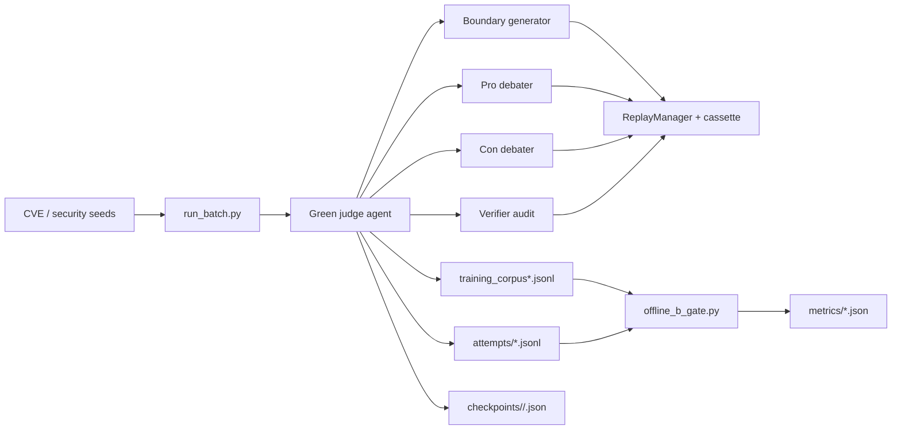

# silver-one

> Changing world values are inputs. Inputs are recorded. Recorded inputs are replayable. Replayable workflows are evolvable.

`silver-one` is an Agentbeats research project for generating auditable code-security reasoning data. Its long-term goal is to build the kind of grounded corpus needed to train safer security-reasoning models: models that learn from concrete evidence hooks, mechanism-level invariants, verifier feedback, and rejected failure cases instead of shallow vulnerable/safe labels.

The project is a continuation of the In-Varia metacognitive-control research direction and the Google DeepMind/Kaggle AGI hackathon work behind MCSB v2. That earlier work showed that models can look calibrated in static settings while failing to update beliefs correctly under adversarial code-security evidence. `silver-one` moves from measuring that failure mode toward producing better training data for it.

The main implemented scenario builds upon **BARRED** (*Boundary Alignment Refinement through REflection and Debate*), the foundational multi-agent security debate paradigm from Plural AI literature. In `silver-one`, this is evolved into **BARRED-Swarm** (*Boundary-Aware Reflective Robust Exploration & Debate*):
- a Green agent (`adk_debate_judge.py`) orchestrates debate rounds,
- two Purple agents (`debater.py`) argue opposite sides,
- an optional Verifier agent (`adk_debate_verifier.py`) audits groundedness,
- outputs are written as training corpus rows and audited with an offline B-gate.

## The BARRED Swarm Architecture

The six core architectural pillars extending the original debate formulation are:

| Letter | Architectural Component | Role in the Swarm |
| :---: | :--- | :--- |
| **B** | **Boundary-Aware** | Extracts vulnerability dimensions (CVE predicates, boundary conditions, reachability constraints) and synthesizes edge-case code samples. |
| **A** | **Asymmetric** | Orchestrates opposing purple agents (Pro-Attacker vs. Con-Defender) supervised by a green judge to eliminate hallucinated consensus. |
| **R** | **Reflective** | Executes iterative refinement via the GEPA Reflector (reflective meta-prompt mutation and diagnostic triage across refinement rounds). |
| **R** | **Robust** | Enforces deterministic quality floors via the B-Gate (AST parse coverage, strict anchor grounding, zero logic errors, and parse reliability). |
| **E** | **Exploration** | Drives stratified, scenario-grouped cross-validation across holdouts to ensure zero data leakage between train/test partitions. |
| **D** | **Debate / Dataset** | Generates verified, high-fidelity synthetic training corpora used to train and evaluate code-security guardrail models. |

## Why This Matters

LLM-generated security datasets and agent evaluations are easy to make and hard to trust. Small hidden changes in prompts, model sampling, timestamps, tool calls, or verifier behavior can change which rows enter a corpus. If those rows are later used for training, hidden errors become training signal.

`silver-one` treats changing values as recorded inputs so generated rows can be audited, replayed, resumed, and rejected when the evidence is weak. The goal is not to maximize synthetic data volume. The goal is to produce a deep reasoning corpus whose verdicts, anchors, mechanisms, verifier outcomes, model controls, rejected attempts, and run state are inspectable after the fact.

The intended downstream use is training and evaluating safer code-security reasoning models. In this repo, "safer" means evidence-grounded, less prone to unsupported vulnerability claims, more explicit about uncertainty and failure modes, and easier to audit when a generated row is wrong.

## Where This Is Headed

`silver-one` is building toward a SecurityDecisionGuard-style training loop: generate high-fidelity code-security examples, debate the boundary condition, verify the mechanism, reject unsupported labels, and preserve enough trace data for later audit.

The near-term artifact is a **Deep Reasoning Corpus** for code security. Each accepted row should teach more than a label. It should expose the evidence hooks, mechanism-level invariants, counterfactual boundary, verifier judgment, model controls, and failure cases that shaped the decision.

The longer-term objective is to train and evaluate safer security-reasoning models: models that reason from grounded evidence, update under adversarial evidence, avoid shallow vulnerability claims, and make their uncertainty and failure modes visible enough for humans to inspect.


## Who This Is For

- AI evaluation researchers building reproducible agent benchmarks.
- Security dataset builders who need grounded vulnerability examples and rejected counterexamples rather than unsupported labels.
- Model builders training code-security reasoning models from auditable synthetic data.
- Agent framework maintainers studying checkpoint/resume, replay, and verifier boundaries.
- Engineers comparing model behavior across local, cloud, and Kaggle benchmark providers.

## Current Status

`silver-one` is early-stage research infrastructure under active development. It does not yet have broad public adoption, stars, or package downloads. It does have a working local harness, deterministic replay machinery, checkpointed batch execution, verifier accounting, calibrated corpus gates, and concrete run metrics from repeated pilot batches.

Use it today as an experimental evaluation harness, not as a polished production package.

## What This Repo Contains

- Agent runtime primitives under `src/agentbeats`.
- A complete debate scenario under `scenarios/debate`.
- Determinism tooling (record/replay cassettes and run records).
- Batch and Kaggle runners for larger corpus generation.
- Offline quality gates for structural completeness, anchor grounding, verifier parse/pass rates, logic-error leakage, and token efficiency.

## Architecture At A Glance



For the fuller Mermaid breakdown and stress-test playbook, see `docs/ARCHITECTURE_MERMAID.md`.

## Reproducible Smoke Path

Start the BARRED stack:

```bash
./scenarios/debate/start_stack.sh
```

In a second terminal, run a clocked batch:

```bash
uv run python scenarios/debate/run_batch.py \
  --run-id pilot-v1-clocked \
  --seed 42 \
  --mode record \
  --clock-now 2026-05-31T16:06:00Z \
  --seeds scenarios/debate/cve_seeds_test.jsonl \
  --output training_corpus_clocked.jsonl \
  --attempts-out artifacts/attempts/pilot-v1-clocked.jsonl
```

Compute B-gate metrics:

```bash
uv run python scenarios/debate/offline_b_gate.py \
  --input training_corpus_clocked.jsonl \
  --attempts artifacts/attempts/pilot-v1-clocked.jsonl \
  --metrics-out artifacts/metrics/b_gate-pilot-v1-clocked.json
```

## Latest Calibrated Results

After predicate-quality calibration and logic-error gating, the clean calibrated runs showed stable quality with lower yield:

| Metric | Calibrated B | Calibrated C |
| :--- | ---: | ---: |
| B-gate pass | `true` | `true` |
| Accepted rows | `11` | `10` |
| Attempts | `30` | `31` |
| Predicate-quality fail rate | `0.0909` | `0.0870` |
| Accepted logic-error count | `0` | `0` |
| Verifier parse OK rate | `1.00` | `1.00` |
| Strict B2 fail rate | `0.1034` | `0.0645` |
| Mechanism grounding fail rate | `0.0333` | `0.0000` |
| Tokens / accepted row | `94,480` | `98,304` |

Interpretation: corpus cleanliness improved, placeholder predicates are rejected, verifier logic errors no longer leak into accepted rows, and the next optimization target is yield/token efficiency rather than predicate calibration.

## Artifact Hygiene

Generated corpora, cassettes, attempts, metrics, checkpoints, and local `.env` files are intentionally ignored by git. Keep committed changes focused on harness code, seed definitions, tests, docs, and reproducible commands. Run artifacts should be attached to reports or copied into docs only when they are intentionally curated.

## Architecture

### Core runtime (`src/agentbeats`)

- `run_scenario.py`: starts participant and green agents from scenario TOML, waits for readiness, optionally launches the client.
- `client_cli.py`: sends `assessment_request` payload to the green agent and streams updates/artifacts.
- `client.py`: A2A messaging helpers.
- `green_executor.py`: base green-agent execution wrapper.
- `models.py`: shared Pydantic request/result models.
- `replay.py`: deterministic run infrastructure (`RunRecord`, `LLMCassette`, `ReplayManager`).
- `structured_output.py`: robust structured-output parser/repair pipeline for JSON responses.

### Debate scenario (`scenarios/debate`)

- `adk_debate_judge.py`: primary BARRED green agent with orchestration, strict gates, and export logic.
- `debater.py`: participant debater agent.
- `adk_debate_verifier.py`: optional verifier used for mechanism/anchor audits.
- `data_generator.py`: boundary-sample generation and refinement for BARRED loops.
- `run_batch.py`: seed-driven batch execution against the running judge.
- `offline_b_gate.py`: offline quality gate and metrics computation over generated corpus.
- `scenario.toml`: minimal debate scenario.
- `barred_test.toml`: BARRED scenario including verifier participant.

## Installation

### Seed Datasets & Anti-Leakage Clean-Room Isolation

To keep the Git repository lightweight, large seed datasets are excluded from Git tracking and published on **Hugging Face Hub** ([`surfiniaburger/cve-decision-seeds`](https://huggingface.co/datasets/surfiniaburger/cve-decision-seeds)).

- **Running Debates & Smoke Tests (Swarm Persona):** The repository includes a lightweight fixture (`scenarios/debate/cve_seeds_test.jsonl`). To pull the full 500 clean seeds corpus in one step:
  ```bash
  uv run python scripts/download_from_huggingface.py
  ```
- **Reproducing or Expanding Seeds (Curator Persona):** Ingest raw CVEs from [CVEFixes (1.4 GB)](https://www.kaggle.com/datasets/girish17019/cvefixes-vulnerable-and-fixed-code) while excluding evaluation samples from [cve-decision (254 MB)](https://www.kaggle.com/datasets/surfiniaburger/cve-decision) to prevent benchmark leakage. See [SEED_GENERATION_GUIDE.md](scenarios/debate/SEED_GENERATION_GUIDE.md) for full instructions.


### Prerequisites

- Python `>=3.11`
- `uv`
- model provider access (for example Ollama local models or remote LiteLLM providers)

### Setup

```bash
git clone https://github.com/surfiniaburger/silver-one.git
cd silver-one
uv sync
cp sample.env .env
```

Configure API/provider environment variables in `.env` as needed.

## Quick Start

Run the default debate scenario:

```bash
uv run agentbeats-run scenarios/debate/scenario.toml
```

Run with logs:

```bash
PYTHONPATH=src uv run agentbeats-run scenarios/debate/scenario.toml --show-logs
```

Serve agents only (no client run):

```bash
uv run agentbeats-run scenarios/debate/scenario.toml --serve-only
```

### Model overrides

The scenario reads model choices from environment variables:

- `JUDGE_MODEL`
- `DEBATER_MODEL`
- `GENERATOR_MODEL`
- `VERIFIER_MODEL`
- `GEPA_MODEL` (used by seed-loader workflows)

### Sampling controls

Tracked LiteLLM calls read and record sampling controls from environment variables:

- `LLM_SAMPLING_PROFILE=ollama_gemma4`
- `LLM_TEMPERATURE`
- `LLM_TOP_P`
- `LLM_TOP_K`
- `LLM_MAX_TOKENS`

The `ollama_gemma4` profile applies Ollama's Gemma 4 sampling recommendation only to tracked models whose name contains `gemma4`:

```bash
temperature=1.0
top_p=0.95
top_k=64
```

These values are written into run records, attempt logs, corpus row metadata, and B-gate metrics so generation settings are treated as control variables rather than hidden confounders.

Example:

```bash
JUDGE_MODEL="ollama/qwen2.5-coder:7b" \
DEBATER_MODEL="ollama/qwen2.5-coder:7b" \
uv run agentbeats-run scenarios/debate/scenario.toml
```

## BARRED Workflow

### Option A: Start the full stack via helper script

```bash
# Terminal 1: Start full stack (judge + debaters + verifier)
./scenarios/debate/start_stack.sh
```

This script:
- kills stale listeners on ports `9009,9018,9019,9020`
- exports default model env vars if not already set
- launches `agentbeats-run scenarios/debate/barred_test.toml --serve-only`

### Option B: Start the full stack directly

```bash
uv run agentbeats-run scenarios/debate/barred_test.toml --serve-only
```

### 2) Run batch generation from seeds

```bash
uv run python scenarios/debate/run_batch.py \
  --seeds scenarios/debate/cve_seeds_50.jsonl \
  --output training_corpus.jsonl \
  --run-id pilot-v1 \
  --seed 42 \
  --mode record
```

### 3) Compute offline B-gate metrics

```bash
uv run python scenarios/debate/offline_b_gate.py \
  --input training_corpus.jsonl \
  --attempts artifacts/attempts/pilot-v1.jsonl \
  --metrics-out artifacts/metrics/b_gate.json
```

### Soft-check run (attempts + B metrics)

Use this exact flow when you want attempts-level soft checks captured and scored:

```bash
# Terminal 1: Start full stack (judge + debaters + verifier)
./scenarios/debate/start_stack.sh

# Re-run a record run to generate attempts with soft_checks

uv run python scenarios/debate/run_batch.py \
  --run-id pilot-v7-poe \
  --seed 42 \
  --mode record \
  --max-concurrency 4 \
  --clock-now 2026-07-25T21:32:53Z \
  --seeds scenarios/debate/cve_seeds_test.jsonl \
  --output training_corpus_v7_poe.jsonl \
  --attempts-out artifacts/attempts/pilot-v7-poe.jsonl \
  --reflector


# Compute B metrics + soft-check rates

./scripts/run_b_gate.sh \
  training_corpus_v7_poe.jsonl \
  artifacts/attempts/pilot-v7-poe.jsonl \
  artifacts/metrics/b_gate-pilot-v7-poe.json


#To compute benchmark metrics for a single run:

uv run python3 scripts/debate_telemetry.py --run-id pilot-v1-calibrated-l

# To run an A/B comparison between baseline and candidate runs with a Markdown report:

uv run python3 scripts/debate_telemetry.py \
  --run-id pilot-v1-calibrated-l \
  --baseline-json artifacts/metrics/debate_benchmark-pilot-v1-calibrated-i.json \
  --output-markdown reports/debate_benchmark_comparison_i_vs_l.md


# Empirical 5-Fold Stratified Grouped CV Benchmark Results

PYTHONPATH=. .venv/bin/python scripts/evaluate_graph_pre_filter.py \
  --attempts-dir artifacts/attempts \
  --output-file artifacts/metrics/graph_pre_filter_cv_report_step2_sources.json \
  --bucket-examples-file artifacts/metrics/graph_pre_filter_bucket_examples_step2.json \
  --bucket-example-limit 3


```

## Determinism and Replay

The project supports deterministic record/replay for model calls.

- **Record mode**: real provider calls are made, responses are cached.
- **Replay mode**: no cache miss is allowed; missing entries fail fast.

Key artifacts:

- `artifacts/cassettes/<run-id>.json`
- `artifacts/runs/<run-id>/<seed>.json`
- `artifacts/runs/<run-id>/batch_manifest.json`
- `artifacts/attempts/<run-id>.jsonl`
- `artifacts/checkpoints/<run-id>/<seed>.json`

Replay example:

```bash
uv run python scenarios/debate/run_batch.py \
  --run-id pilot-v1-calibrated-e \
  --seed 42 \
  --mode replay \
  --clock-now 2026-06-07T12:29:00Z \
  --seeds scenarios/debate/cve_seeds_test.jsonl \
  --output training_corpus_calibrated_e.jsonl \
  --attempts-out artifacts/attempts/pilot-v1-calibrated-e.jsonl
```

Resume a partially completed batch from per-seed workflow checkpoints, (remember to crank the clock before resuming):

```bash
uv run python scenarios/debate/run_batch.py \
  --run-id pilot-v1-calibrated-e \
  --seed 42 \
  --mode record \
  --resume \
  --clock-now 2026-06-07T13:08:00Z \
  --checkpoint-dir artifacts/checkpoints/pilot-v1-calibrated-e \
  --seeds scenarios/debate/cve_seeds_test.jsonl \
  --output training_corpus_calibrated_e.jsonl \
  --attempts-out artifacts/attempts/pilot-v1-calibrated-e.jsonl  
```

Checkpoints preserve the latest durable phase for a seed, including generated sample, debate transcript, judge output, strict-gate state, verifier state, and run controls. Resume validates logical controls, not wall-clock equality: it fails if model choices, sampling config, seed, predicate, target verdict, target dimension, cassette path, or input hash drift, but `clock_now` is recorded as audit metadata rather than used as a strict resume key. Each checkpoint also stores `updated_at`, the actual checkpoint write time.

Batch runs use a base seed plus item index (`item_seed = base_seed + zero_based_index`) and write one run record per item seed. The batch manifest records this seed schedule, per-seed checkpoint paths, per-seed run-record paths, and the injected `clock_now` value used for run records and checkpoints. Set `RUN_CLOCK_NOW` or pass `--clock-now` to freeze artifact timestamps for deterministic replay audits.

## Kaggle Runner

Use the automation helper:

```bash
uv run python kaggle_notebooks/run_barred_kaggle.py \
  --scenario scenarios/debate/barred_test.toml \
  --run-id kaggle-pilot \
  --mode record \
  --seed 42 \
  --seeds scenarios/debate/cve_seeds_50.jsonl \
  --output /kaggle/working/training_corpus.jsonl \
  --attempts-out /kaggle/working/attempts.jsonl \
  --metrics-out /kaggle/working/b_gate.json
```

## Testing

Scenario-level tests currently live under `scenarios/debate`.

```bash
uv run python scenarios/debate/test_structured_output.py
uv run python scenarios/debate/test_offline_b_gate.py
```

If you have `pytest` installed in your environment:

```bash
uv run pytest -q scenarios/debate
```

## Repository Layout

```text
silver-one/
├─ src/agentbeats/
│  ├─ run_scenario.py
│  ├─ client_cli.py
│  ├─ replay.py
│  ├─ structured_output.py
│  └─ ...
├─ scenarios/debate/
│  ├─ adk_debate_judge.py
│  ├─ adk_debate_verifier.py
│  ├─ debater.py
│  ├─ data_generator.py
│  ├─ run_batch.py
│  ├─ offline_b_gate.py
│  ├─ scenario.toml
│  └─ barred_test.toml
├─ kaggle_notebooks/
│  └─ run_barred_kaggle.py
├─ sample.env
├─ pyproject.toml
└─ README.md
```

## Contributing

- Keep changes deterministic-friendly (record/replay aware).
- Update scenario docs if you change config fields in TOML or expected output schema.
- Prefer robust structured JSON parsing via `src/agentbeats/structured_output.py`.

See `AGENT.md` for repository-specific coding and review instructions.

## References & Related Docs

 - **BARRED: Synthetic Training of Custom Policy Guardrails via Asymmetric Debate** — Arnon Mazza*, Elad Levi* (Plurai Inc.), Preprint Jan 21, 2026. Role: scenario specification and debate-based synthetic-data generation algorithm; served as the blueprint for the BARRED scenario, gating rules, and the offline B-gate implementation used in this repo. (*equal contribution)

 - **Pioneer Agent: Continual Improvement of Small Language Models in Production** — Dhruv Atreja, Julia White, Nikhil Nayak, Kelton Zhang, Henrijs Princis, George Hurn-Maloney, Ash Lewis, Urchade Zaratiana (Fastino Labs), arXiv:2604.09791, Apr 10, 2026. Role: engineering systems paper that inspired telemetry-driven adaptation loops used in our evaluation.

 - **GEPA: Reflective Prompt Evolution Can Outperform Reinforcement Learning** — Lakshya A. Agrawal*, Shangyin Tan*, Dilara Soylu*, Noah Ziems*, et al., ICLR 2026 / arXiv:2507.19457. Role: reflective execution-trace prompt adaptation paradigm that replaces scalar-reward RL and naive retries with full natural language failure diagnosis and Pareto frontier prompt selection. (*equal contribution)

 - **[Evaluation Discipline & Anti-Gaming Guardrails Guide](docs/EVALUATION_DISCIPLINE_GUIDE.md)** — Comprehensive specification of the 4 Anti-Gaming Invariants, zero logic error guarantees, leak-proof dataset partitioning, and statistical hypothesis decision rules ($p < 0.05$, $95\%$ CI).

## License

MIT License. See `LICENSE`.

uv run python scenarios/debate/run_batch.py \
  --seeds scenarios/debate/cve_seeds_specific_anchor_10.jsonl \
  --run-id pilot-spec-anchor-10-fresh \
  --output test_corpus_spec_anchor_10_fresh.jsonl \
  --attempts-out artifacts/attempts/pilot-spec-anchor-10-fresh.jsonl \
  --manifest-out artifacts/runs/pilot-spec-anchor-10-fresh/batch_manifest.json \
  --mode record \
  --escalate-pareto \
  --gepa-dir artifacts/gepa_pareto_50 \
  --max-concurrency 1 \
  --counter-evidence-validation-mode \
  -


OPENAI_API_BASE="http://localhost:1234/v1" \
OPENAI_API_KEY="lm-studio" \
DEBATER_MODEL="openai/gemma-4-e4b-it" \
VERIFIER_MODEL="openai/google/gemma-4-12b-qat" \
JUDGE_MODEL="openai/google/gemma-4-12b-qat" \
./scenarios/debate/start_stack.sh


OPENAI_API_BASE="http://localhost:1234/v1" \
OPENAI_API_KEY="lm-studio" \
uv run python scenarios/debate/cve_seed_loader.py \
  --existing-seeds scenarios/debate/cve_seeds_500_clean.jsonl \
  --target-total 524 \
  --output scenarios/debate/cve_seeds_524_clean.jsonl \
  --explainer-model "openai/google/gemma-4-12b-qat" \
  --audit-predicates \
  --auditor-model "vertex_ai/gemini-3.8-flash" \
  --telemetry-path artifacts/telemetry/seed_expansion_gemma12b_lmstudio.json \
  --attempts-path artifacts/telemetry/seed_expansion_gemma12b_lmstudio_attempts.jsonl


uv run python scenarios/debate/run_batch.py \
  --seeds scenarios/debate/cve_seeds_benchmark_50.jsonl \
  --run-id gemini3-baseline-50-rep5 \
  --output test_corpus_gemini3_baseline_50_rep5.jsonl \
  --attempts-out artifacts/attempts/gemini3-baseline-50-rep5.jsonl \
  --manifest-out artifacts/runs/gemini3-baseline-50-rep5/batch_manifest.json \
  --seed 42 \
  --mode record \
  --no-escalate-pareto \
  --no-reflector \
  --slice-judge \
  --max-concurrency 1 \
  --counter-evidence-validation-mode enforce_deterministic \
  --resume


DEBATER_MODEL="vertex_ai/gemini-3.5-flash" \
GENERATOR_MODEL="vertex_ai/gemini-3.5-flash" \
VERIFIER_MODEL="vertex_ai/gemini-3.8-flash" \
JUDGE_MODEL="vertex_ai/gemini-3.8-flash" \
VERTEXAI_LOCATION="global" \
./scenarios/debate/start_stack.sh


uv run python scenarios/debate/run_batch.py \
  --seeds scenarios/debate/cve_seeds_benchmark_50.jsonl \
  --run-id gemini3-escalate-pareto-50-rep5 \
  --output test_corpus_gemini3_escalate_pareto_50_rep5.jsonl \
  --attempts-out artifacts/attempts/gemini3-escalate-pareto-50-rep5.jsonl \
  --manifest-out artifacts/runs/gemini3-escalate-pareto-50-rep5/batch_manifest.json \
  --cassette-path artifacts/cassettes/gemini3-escalate-pareto-50-rep5.json \
  --gepa-dir artifacts/gepa_gemini3_pareto_50 \
  --seed 42 \
  --mode record \
  --escalate-pareto \
  --reflector \
  --reflector-in-process \
  --reflector-mode symmetric \
  --slice-judge \
  --max-concurrency 1 \
  --counter-evidence-validation-mode enforce_deterministic \
  --resume


---

### Uzu Engine & Qwen 3.5 4B On-Device Inference Setup (macOS 26+)

Uzu requires Python 3.12 and Metal 4 (`MTL4CommandQueueDescriptor`, macOS $\ge$ 26).

#### 1. Initialize Python 3.12 Environment & Install `uzu`
```bash
# Create Python 3.12 virtual environment (e.g. in .venv-uzu or /tmp/uzu_env)
uv venv .venv-uzu --python 3.12

# Activate or install via uv pip directly
uv pip install --python .venv-uzu/bin/python uzu
```
*(Note: On macOS 26+, `uv pip install uzu` directly pulls the matching `macosx_26_0_arm64` wheel from PyPI. If installing manually on custom builds, download the wheel from PyPI and install via `uv pip install <wheel_path>`.)*

#### 2. Create the Benchmark Test Script (`scripts/test_uzu_qwen.py`)
```python
import asyncio
import time
from uzu import (
    ChatConfig,
    ChatMessage,
    ChatReplyConfig,
    ChatSessionStreamChunk,
    Engine,
    EngineConfig,
)

async def main():
    print("Creating EngineConfig and Engine...")
    engine = await Engine.create(EngineConfig.create())

    print("Locating model trymirai/Qwen3.5-4B-M...")
    model = await engine.model("trymirai/Qwen3.5-4B-M")
    if model is None:
        raise RuntimeError("Model trymirai/Qwen3.5-4B-M not found")

    print("Downloading / Verifying cached model weights (in ~/.cache/mirai)...")
    downloader = await engine.download(model)
    async for update in downloader.iterator():
        pct = int(update.progress * 100)
        if pct % 20 == 0:
            print(f"Progress: {pct}%")

    print("\nStarting Chat Session with C Vulnerability Analysis prompt...")
    session = await engine.chat(model, ChatConfig.create())

    test_prompt = """
Analyze the following C function for security vulnerabilities:
void process_packet(char *data, int len) {
    char buffer[64];
    if (len > 0) {
        strcpy(buffer, data);
    }
}
Identify the vulnerability, source anchor, and sink anchor. Keep your response brief.
"""
    messages = [
        ChatMessage.system().with_text("You are an expert security auditor and formal verification debater."),
        ChatMessage.user().with_text(test_prompt.strip()),
    ]

    t_start = time.time()
    stream = await session.reply_with_stream(messages, ChatReplyConfig.create())
    output_tokens = 0
    full_text = []

    async for chunk in stream.iterator():
        if isinstance(chunk, ChatSessionStreamChunk.Replies):
            for reply in chunk.replies:
                if reply.message and reply.message.text:
                    full_text.append(reply.message.text)
                if hasattr(reply, "stats") and reply.stats:
                    output_tokens = getattr(reply.stats, "tokens_count_output", output_tokens)
        elif isinstance(chunk, ChatSessionStreamChunk.Error):
            print(f"Stream error: {chunk.error}")

    elapsed = time.time() - t_start
    print("\n--- MODEL RESPONSE ---")
    print("".join(full_text))
    print("----------------------")
    print(f"Elapsed: {elapsed:.3f}s")
    if output_tokens > 0:
        print(f"Output tokens: {output_tokens}")
        print(f"Throughput: {output_tokens / elapsed:.1f} tokens/sec")

if __name__ == "__main__":
    asyncio.run(main())
```

#### 3. Run the Verification Command
```bash
.venv-uzu/bin/python scripts/test_uzu_qwen.py
```
*(Pre-downloaded 2.3 GB checkpoint is stored at `~/.cache/mirai/models/mirai/alibaba-qwen3.5-4b-mirai-mirai-m-4/` and will be loaded directly into Metal GPU unified memory.)*


---

### Pilot 10-Seed Debate Benchmark (LM Studio Gemma 12B QAT + Gemini 3.8 Flash Judge)

**Prerequisites:** LM Studio running locally with `google/gemma-4-12b-qat` loaded, Vertex AI credentials configured.

#### Step 1: Start the Debate Stack (LM Studio Debater + Gemini Flash Judge)

```bash
OPENAI_API_BASE="http://localhost:1234/v1" \
OPENAI_API_KEY="lm-studio" \
DEBATER_MODEL="openai/google/gemma-4-12b-qat" \
GENERATOR_MODEL="openai/google/gemma-4-12b-qat" \
VERIFIER_MODEL="openai/google/gemma-4-12b-qat" \
JUDGE_MODEL="openai/google/gemma-4-12b-qat" \
./scenarios/debate/start_stack.sh
```


uv run python scenarios/debate/run_batch.py \
  --seeds scenarios/debate/cve_seeds_smoke_2.jsonl \
  --run-id gemma-smoke-armA-raw-noesc \
  --output artifacts/factorial/corpus_armA_gemma_smoke.jsonl \
  --attempts-out artifacts/attempts/gemma-smoke-armA.jsonl \
  --manifest-out artifacts/runs/gemma-smoke-armA/batch_manifest.json \
  --seed 42 \
  --mode record \
  --no-slice-judge \
  --no-reflector \
  --no-escalate-pareto \
  --max-concurrency 1 \
  --counter-evidence-validation-mode enforce_deterministic


#### Step 2: Run the 10-Seed Pilot Batch (in a second terminal)

```bash
OPENAI_API_BASE="http://localhost:1234/v1" \
OPENAI_API_KEY="lm-studio" \
DEBATER_MODEL="openai/google/gemma-4-12b-qat" \
VERIFIER_MODEL="openai/google/gemma-4-12b-qat" \
JUDGE_MODEL="vertex_ai/gemini-3.8-flash" \
uv run python scenarios/debate/run_batch.py \
  --seeds scenarios/debate/cve_seeds_pilot_10.jsonl \
  --run-id lmstudio-gemma12b-pilot-10 \
  --output test_corpus_lmstudio_gemma12b_pilot_10.jsonl \
  --attempts-out artifacts/attempts/lmstudio-gemma12b-pilot-10.jsonl \
  --manifest-out artifacts/runs/lmstudio-gemma12b-pilot-10/batch_manifest.json \
  --cassette-path artifacts/cassettes/lmstudio-gemma12b-pilot-10.json \
  --gepa-dir artifacts/gepa_lmstudio_pilot_10 \
  --seed 42 \
  --mode record \
  --escalate-pareto \
  --reflector \
  --reflector-in-process \
  --reflector-mode symmetric \
  --slice-judge \
  --max-concurrency 1 \
  --counter-evidence-validation-mode enforce_deterministic \
  --resume
```

### Option B: Qwen 3.5 4B via Uzu Proxy (Metal-Accelerated, ~80 tok/s)

We built an OpenAI-compatible FastAPI proxy ([`scripts/uzu_proxy.py`](file:///Users/surfiniaburger/Desktop/modular-metacog-swarm-v3/agent_training/silver-one/scripts/uzu_proxy.py)) wrapping Uzu's native Metal SDK with support for `/v1/chat/completions` (streaming & non-streaming) and `/v1/models`.

**1. Start the Uzu Proxy (Terminal 0):**
```bash
./scripts/start_uzu_proxy.sh
# Runs on http://localhost:8000 serving trymirai/Qwen3.5-4B-M
```

**2. Start the Debate Stack (Debater/Verifier: Uzu Qwen | Judge: LM Studio Gemma 12B) (Terminal 1):**
```bash
./scenarios/debate/start_uzu_gemma_stack.sh
```
*(This automatically exports `DEBATER_MODEL` & `VERIFIER_MODEL` to `openai/trymirai/Qwen3.5-4B-M` on `localhost:8000` and `JUDGE_MODEL` to `openai/google/gemma-4-12b-qat` on `localhost:1234`)*


**3. Run the Benchmark Batch (Terminal 2):**
```bash
uv run python scenarios/debate/run_batch.py \
  --seeds scenarios/debate/cve_seeds_pilot_10.jsonl \
  --run-id uzu-qwen-gemma12b-pilot-10 \
  --output test_corpus_uzu_qwen_gemma12b_pilot_10.jsonl \
  --attempts-out artifacts/attempts/uzu-qwen-gemma12b-pilot-10.jsonl \
  --manifest-out artifacts/runs/uzu-qwen-gemma12b-pilot-10/batch_manifest.json \
  --cassette-path artifacts/cassettes/uzu-qwen-gemma12b-pilot-10.json \
  --gepa-dir artifacts/gepa_uzu_qwen_pilot_10 \
  --seed 42 \
  --mode record \
  --escalate-pareto \
  --reflector \
  --reflector-in-process \
  --reflector-mode symmetric \
  --slice-judge \
  --max-concurrency 1 \
  --counter-evidence-validation-mode enforce_deterministic
```

### Option C: All-Qwen 3.5 4B via Uzu Proxy (Debater + Verifier + Judge)

To run **all roles** (Debater, Verifier, and Judge) fully accelerated locally via Uzu on Apple Silicon Metal:

**1. Start the Uzu Proxy (Terminal 0):**
```bash
./scripts/start_uzu_proxy.sh
```

**2. Start the All-Qwen Debate Stack (Terminal 1):**
```bash
./scenarios/debate/start_all_qwen_stack.sh
```

**3. Run the Benchmark Batch (Terminal 2):**
```bash
uv run python scenarios/debate/run_batch.py \
  --seeds scenarios/debate/cve_seeds_pilot_10.jsonl \
  --run-id uzu-all-qwen-pilot-101 \
  --output test_corpus_uzu_all_qwen_pilot_101.jsonl \
  --attempts-out artifacts/attempts/uzu-all-qwen-pilot-101.jsonl \
  --manifest-out artifacts/runs/uzu-all-qwen-pilot-101/batch_manifest.json \
  --cassette-path artifacts/cassettes/uzu-all-qwen-pilot-101.json \
  --gepa-dir artifacts/gepa_uzu_all_qwen_pilot_101 \
  --seed 42 \
  --mode record \
  --escalate-pareto \
  --reflector \
  --reflector-in-process \
  --reflector-mode symmetric \
  --slice-judge \
  --max-concurrency 1 \
  --counter-evidence-validation-mode enforce_deterministic \
  --resume
```


uv run python scenarios/debate/run_batch.py \
  --seeds scenarios/debate/cve_seeds_benchmark_50.jsonl \
  --run-id track2-gemm-armA-raw-noesc-rep1 \
  --output test_corpus_track2_gemm_armA_rep1.jsonl \
  --attempts-out artifacts/attempts/track2-gemm-armA-rep1.jsonl \
  --manifest-out artifacts/runs/track2-gemm-armA-rep1/batch_manifest.json \
  --seed 42 \
  --mode record \
  --no-slice-judge \
  --no-reflector \
  --no-escalate-pareto \
  --max-concurrency 1 \
  --counter-evidence-validation-mode enforce_deterministic


SEND_MESSAGE_TIMEOUT=1800 uv run python scenarios/debate/run_batch.py \
  --seeds scenarios/debate/cve_seeds_smoke_2.jsonl \
  --run-id ql-smoke-armA-raw-noesc \
  --output artifacts/factorial/corpus_armA_ql_smoke.jsonl \
  --attempts-out artifacts/attempts/ql-smoke-armA.jsonl \
  --manifest-out artifacts/runs/ql-smoke-armA/batch_manifest.json \
  --seed 42 \
  --mode record \
  --no-slice-judge \
  --no-reflector \
  --no-escalate-pareto \
  --max-concurrency 1 \
  --counter-evidence-validation-mode enforce_deterministic


uv run python scenarios/debate/run_batch.py \
  --seeds scenarios/debate/cve_seeds_smoke_2.jsonl \
  --run-id ql-smoke-armB-struct-noesc \
  --output artifacts/factorial/corpus_armB_ql_smoke.jsonl \
  --attempts-out artifacts/attempts/ql-smoke-armB.jsonl \
  --manifest-out artifacts/runs/ql-smoke-armB/batch_manifest.json \
  --gepa-dir artifacts/gepa_ql_pareto_smoke \
  --seed 42 \
  --mode record \
  --slice-judge \
  --reflector \
  --reflector-in-process \
  --reflector-mode symmetric \
  --no-escalate-pareto \
  --max-concurrency 1 \
  --counter-evidence-validation-mode enforce_deterministic


uv run python scenarios/debate/run_batch.py \
  --seeds scenarios/debate/cve_seeds_smoke_2gate.jsonl \
  --run-id q9d-struct-esc \
  --output artifacts/factorial/corpus_armC_q9d_smoke.jsonl \
  --attempts-out artifacts/attempts/q9d-smoke-armC.jsonl \
  --manifest-out artifacts/runs/q9d-smoke-armC/batch_manifest.json \
  --gepa-dir artifacts/gepa_q9d_pareto_smoke \
  --seed 42 \
  --mode record \
  --slice-judge \
  --reflector \
  --reflector-in-process \
  --reflector-mode symmetric \
  --escalate-pareto \
  --max-concurrency 1 \
  --counter-evidence-validation-mode enforce_deterministic \
  --halt-on-con-win

SEND_MESSAGE_TIMEOUT=600 uv run python scenarios/debate/run_batch.py \
  --seeds scenarios/debate/cve_seeds_smoke_2gate.jsonl \
  --run-id q9b-gate-smoke-v2 \
  --gepa-dir artifacts/gepa_q9d_pareto_smoke \
  --output artifacts/factorial/corpus_gate_smoke_v2.jsonl \
  --attempts-out artifacts/attempts/gate-smoke-v2.jsonl \
  --manifest-out artifacts/runs/gate-smoke-v2/batch_manifest.json \
  --seed 42 --mode record --slice-judge --reflector --reflector-in-process \
  --reflector-mode symmetric --escalate-pareto --max-concurrency 1 \
  --counter-evidence-validation-mode enforce_deterministic --halt-on-con-win

uv run python scenarios/debate/run_batch.py \
  --seeds scenarios/debate/cve_seeds_smoke_2.jsonl \
  --run-id ql-smoke-armD-raw-esc \
  --output artifacts/factorial/corpus_armD_ql_smoke.jsonl \
  --attempts-out artifacts/attempts/ql-smoke-armD.jsonl \
  --manifest-out artifacts/runs/ql-smoke-armD/batch_manifest.json \
  --gepa-dir artifacts/gepa_ql_pareto_smoke \
  --seed 42 \
  --mode record \
  --no-slice-judge \
  --no-reflector \
  --escalate-pareto \
  --max-concurrency 1 \
  --counter-evidence-validation-mode enforce_deterministic


SEND_MESSAGE_TIMEOUT=600 uv run python scenarios/debate/run_batch.py \
  --seeds scenarios/debate/cve_seeds_smoke_2gate.jsonl \
  --run-id q9b-gate-smoke-v3 \
  --output artifacts/factorial/corpus_gate_smoke_v3.jsonl \
  --gepa-dir artifacts/gepa_q9dl_pareto_smoke \
  --attempts-out artifacts/attempts/gate-smoke-v3.jsonl \
  --manifest-out artifacts/runs/gate-smoke-v3/batch_manifest.json \
  --seed 42 --mode record --slice-judge --reflector --reflector-in-process \
  --reflector-mode symmetric --escalate-pareto --max-concurrency 1 \
  --counter-evidence-validation-mode enforce_deterministic --halt-on-con-win


uv run python scenarios/debate/run_batch.py \
  --seeds scenarios/debate/cve_seeds_smoke_2gate.jsonl \
  --run-id m9bol-gate-smoke-v10 \
  --output artifacts/factorial/corpus_gateol_smoke_v10.jsonl \
  --gepa-dir artifacts/gepa_m9dl_pareto_smoke \
  --attempts-out artifacts/attempts/gateol-smoke-v10.jsonl \
  --manifest-out artifacts/runs/gateol-smoke-v10/batch_manifest.json \
  --seed 42 --mode record --slice-judge --reflector --reflector-in-process \
  --reflector-mode symmetric --escalate-pareto --max-concurrency 1 \
  --counter-evidence-validation-mode enforce_deterministic --halt-on-con-win