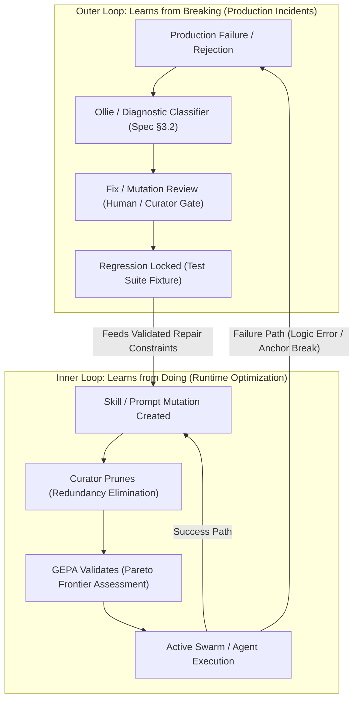
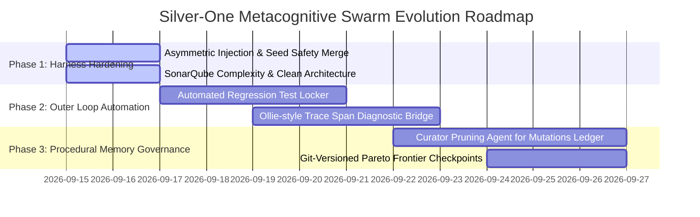

# Production Agent Harness: Dual-Loop Self-Repair & Metacognitive Swarm Roadmap

> **Reference Context**: Analysis of Avi Chawla’s (*Daily Dose of Data Science*) architectural doctrine on production agent harnesses (*"What It Takes to Build a Production Agent Harness"* & *"Your agent harness should repair itself"*), cross-referenced with empirical findings from the `silver-one` / BARRED debate verification engine.

---

## 1. Executive Summary

A production AI agent is fundamentally more than an LLM chained to a collection of tool APIs. It is an **execution harness** that arbitrates application state, model context, tool failures, recovery policies, and runtime learning.

Recent research highlights two parallel feedback loops that govern agent evolution without weight fine-tuning:
1. **The Inner Loop ("Learns from Doing")**: Fast, autonomous procedural memory generation (skill creation, prompt mutation, Pareto optimization, and pruning) to sharpen performance on successful tasks.
2. **The Outer Loop ("Learns from Breaking")**: Rigorous, trace-grounded incident analysis, diagnostic classification, human/curator approval, and regression test locking to ensure the harness gets harder to break with every production failure.

In the `silver-one` repository, our implementation of the **BARRED** (B-gate Adversarial Reflector & Replay Engine for Debate) architecture directly embodies these principles. This document synthesizes the lessons, critiques current implementation trade-offs, and establishes the technical roadmap for the next development phase.

---

## 2. Theoretical Architecture & Visual Models

### 2.1 The Dual-Loop Self-Repair Cycle



* **Inner Loop Dynamics**: Operates at execution time. The swarm attempts tasks, captures high-performing invariant strategies, and records candidate prompt mutations in the GEPA ledger.
* **Outer Loop Dynamics**: Operates across incidents. Uncaught hallucinations, logic contradictions, or anchor mismatches are captured via span-level traces, categorized by strict precedence diagnostic buckets, validated against regression suites, and committed with provenance.

---

### 2.2 The Four Golden Constraints of Agent Reliability

```
┌──────────────────────────────────────────────────┬──────────────────────────────────────────────────┐
│ 1. Not Every Failure Becomes a Test              │ 2. Judge for Behavior, Validator for Facts       │
│                                                  │                                                  │
│   [Timeout]      [Bad Answer]   [Invalid Tool]   │       [LLM Judge]        [Deterministic]         │
│       │               │                │         │            │               [Validator]           │
│       ▼               ▼                ▼         │            ▼                    │                │
│    (Triage)       (Behavior)       (Contract)    │      Plain-language             ▼                │
│                                                  │       argumentation     Schemas, AST graphs,     │
│   Converting every anomaly produces noise.       │        evaluation       line anchors, exit codes │
├──────────────────────────────────────────────────┼──────────────────────────────────────────────────┤
│ 3. One Rerun Proves One Case                     │ 4. Learned Artifacts Need Versioning             │
│                                                  │                                                  │
│    [Rerun Passed] ──► [Broader Suite Check]      │   Skill + Prompt + Tool + Config ──► Change v12  │
│                                                  │                                                  │
│   A localized fix can silently regress other     │   Traceable, reproducible, and rollback-ready    │
│   invariants without full-suite evaluation.      │   procedural memory artifacts.                   │
└──────────────────────────────────────────────────┴──────────────────────────────────────────────────┘
```

1. **Not Every Failure Becomes a Test**: Differentiate transient transport timeouts, incomplete generations, and hard factual contradictions. Only structured contract violations warrant regression suite expansion.
2. **Judge for Behavior, Validator for Facts**: Use LLM judges solely for plain-language critique and nuance. Use deterministic validators (Tree-sitter AST parsers, anchor normalizers, B-gate metrics) for hard facts.
3. **One Rerun Proves One Case**: A single green execution of a repaired prompt proves only that the prompt fixed that specific reproduction. The patch must be evaluated against the wider benchmark before promotion.
4. **Learned Artifacts Need Versioning**: System prompts, topological repair directives, and Pareto frontiers must be treated as version-controlled code artifacts, stamped with Git commit hashes and rollback procedures.

---

## 3. Dissecting the Key System Design Questions

### Q1: Which state belongs to the current run vs. across conversations?
* **Current Run State**: Ephemeral AST snapshots, intermediate debate transcripts, candidate generated code blocks, token telemetry spans, and step checkpoints (`generated_sample`, `debate_complete`, `verifier_complete`).
* **Cross-Conversation / Persistent State**: The Pareto frontier (`pareto_frontier.json`), the historical mutation ledger (`mutations.jsonl`), known dead-end constraints, and regression cassettes (`artifacts/cassettes/`).
* **Risk & Mitigation**: State bleeding occurs when intermediate debate failures contaminate the persistent ledger without passing Pareto dominance thresholds. `silver-one` mitigates this via strict B-gate qualification prior to `register_pareto_prompt`.

### Q2: Which transitions can be model-driven vs. deterministic?
* **Deterministic Transitions**:
  1. Pre-filter cascade routing (BARRED 3-stage model gate).
  2. Syntactic validity and AST completeness check via Tree-sitter.
  3. Source-to-sink reachability analysis and anchor matching (`b2_anchor_match_rate`).
  4. Diagnostic classification ordering (Precedence §3.2).
  5. B-gate metric thresholding (e.g. `accepted_attempt_logic_error_rate == 0.0`).
* **Model-Driven Transitions**:
  1. Adversarial code mutation along the target dimension (`data_generator.py`).
  2. Debater argument synthesis and rebuttal formulation (`adk_debate_judge.py`).
  3. Natural language critique and reasoning in adjudication.

### Q3: Which production failure is most valuable to preserve as a regression case?
* The most dangerous failures are **silent epistemic hallucinations**: instances where the LLM debate judge awards victory to an argument that appears superficially persuasive but is mathematically impossible in code.
* **Real-World Case Study (Seed 47 - OpenVPN Parse)**:
  - In our benchmark, the Pro debater convinced the judge that an unchecked `alen` field caused an Out-of-Bounds memory read.
  - The deterministic verifier audit caught the contradiction: the guard `(data_start_offset + 8) <= ovpn_payload_len` mathematically prevented any read beyond buffer bounds.
  - Converting such verifier-rejected false positives into permanent regression fixtures protects the swarm from epistemic drift.

---

## 4. Current State: Where Silver-One Stands

Our empirical benchmarks confirm that `silver-one` has successfully validated several core tenets of the production harness:

### 4.1 Proven Strengths
1. **GEPA In-Process Evolution Outperforms Raw Parameter Scale**:
   - `gemma-4-e4b` (4B) paired with `gemma-4-12b-fast` (12B) and primed with our evolved local Pareto ledger (`artifacts/gepa_local`, score: 61.13) achieved **21,234.9 tokens/accepted row** with a **70% Round 0 acceptance yield**.
   - This outperformed a 31B/120B cloud model stack (`gemma4:31b` + `gpt-oss:120b`, score: 10.3) which consumed **32,783.2 tokens/row** at a 60% yield.
   - **Conclusion**: A compact model equipped with domain-evolved topological repair directives outperforms a massive model operating from a generic baseline prompt.
2. **Hybrid Fact/Behavior Separation**:
   - The LLM acts strictly as an advocate/skeptic debater and adjudicator.
   - Factuality is enforced by deterministic code scanners (`graphify_flow_extractor.py`), Tree-sitter scope stacks, and offline B-gate calculators (`offline_b_gate.py`).

### 4.2 Identified Vulnerabilities & Resolved Anti-Patterns
1. **Symmetric Injection Defect (Resolved)**:
   - *Issue*: Injecting the Pareto champion prompt symmetrically into both `pro_mission` and `con_mission` armed the skeptic with the advocate's exact repair strategy, neutralizing Round 1 multi-round recovery.
   - *Fix*: Asymmetric injection—Pro and the Generator receive the topological repair directive; Con remains a neutral, unpolluted skeptical auditor.
2. **Seed Safety Inversion (Resolved)**:
   - *Issue*: Hardcoding `target_verdict: "True"` forced Pro to defend non-existent vulnerabilities on safe seeds or negative predicates (e.g. *"The code is not vulnerable..."*). When Con proved the code was safe, the harness rejected the run as `con_win_not_applicable`.
   - *Fix*: Dynamic target verdict alignment (`resolve_target_verdict`) based on ground truth and predicate polarity, paired with acceptance of validated counter-evidence Con wins.
3. **Artifact Provenance Gap (Under Remediation)**:
   - Unversioned divergence between `artifacts/gepa` (cloud) and `artifacts/gepa_local` (local) caused unexplained performance variations across environments.

---

## 5. Strategic Roadmap: Where We Must Go Next



### Phase 1: Harness Hardening & Core Pipeline Integrity (Current)
- [x] Implement asymmetric reflector injection in [`scenarios/debate/adk_debate_judge.py`](../scenarios/debate/adk_debate_judge.py).
- [x] Inject reflector prompts into `generate_boundary_sample` and `refine_sample` in [`scenarios/debate/data_generator.py`](../scenarios/debate/data_generator.py).
- [x] Implement dynamic polarity resolution in [`scenarios/debate/run_batch.py`](../scenarios/debate/run_batch.py).
- [x] Refactor nested conditionals to resolve SonarQube S3358 and satisfy Cognitive Complexity thresholds.
- [x] Validate against full 434-test offline test suite.

### Phase 2: Outer-Loop Regression Locking (Next Sprint)
- [ ] **Automated Regression Test Locker**: Create an automated bridge that converts every attempt rejected with `B_LOGIC_ERROR` or verified hallucination into a locked pytest fixture in `tests/regression/`.
- [ ] **Trace-Span Diagnostics**: Integrate span-level causal tracking so that when a multi-round debate fails, the exact diverging argument turn is isolated and classified automatically without manual transcript grepping.

### Phase 3: Procedural Memory Governance & Versioning
- [ ] **Curator Agent for Ledger Pruning**: When `mutations.jsonl` exceeds 250 variants, trigger an automated semantic clustering job to prune redundant variants, merge overlapping repair directives, and retire dead-ends.
- [ ] **Pareto Frontier Version Control**: Establish a formal promotion gate where `pareto_frontier.json` is stamped as a versioned release artifact (e.g., `pareto_frontier_v1.0.json`) tied to Git tags and benchmark receipts.

---

## 6. Conclusion

The transition from a simple tool-calling loop to a self-repairing agent harness is the defining paradigm of reliable AI systems engineering. By combining deterministic Tree-sitter fact validation, asymmetric genetic prompt evolution, and automated regression locking, `silver-one` achieves mathematically verifiable security auditing that improves systematically with every run.
