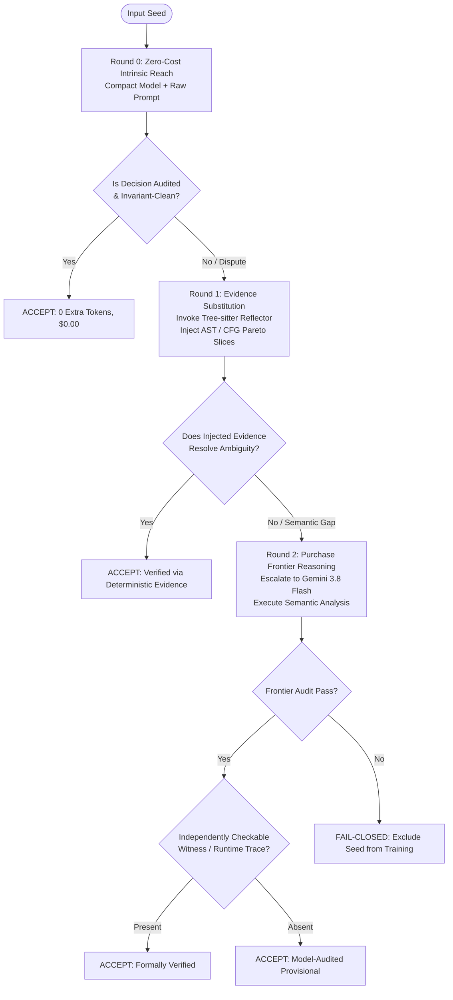

# RFC-EPISTEMIC-REACH-V1: Epistemic Reach, Evidence Substitution, and Oracle Authority

- **Document ID:** `RFC_EPISTEMIC_REACH_AND_EVIDENCE_SUBSTITUTION_V1`
- **System:** `silver-one` / BARRED-Swarm Neurosymbolic Architecture
- **Status:** Approved / Core Architectural Foundation
- **Date:** October 2026

---

## 1. Executive Summary & Foundational Thesis

In autonomous code analysis and multi-agent debate systems, empirical evaluations frequently collapse multiple distinct causal factors into a single scalar: **"benchmark accuracy"** or **"acceptance rate."** 

This conflation obscures the root causes of system failures, leading engineers to either prematurely discard valid architectures or over-invest in massive frontier LLMs to compensate for deterministic plumbing flaws.

We define the foundational epistemic thesis of the `silver-one` architecture:

> **The model has reasoning reach. The reflector has evidence reach. The oracle has labeling authority. These are not the same thing.**

```text
                 ┌────────────────────────────────────────────────────────┐
                 │                HUMAN BENCHMARK ORACLE                  │
                 │                 [Labeling Authority]                   │
                 │              "This codebase is Vulnerable"             │
                 └───────────────────────────┬────────────────────────────┘
                                             │
                                             │ asserts binary label
                                             ▼
                 ┌────────────────────────────────────────────────────────┐
                 │                  CLAIMED PREDICATE                     │
                 │            "Vulnerable via specific mechanism M"       │
                 └───────────────────────────┬────────────────────────────┘
                                             │
                       ┌─────────────────────┴─────────────────────┐
                       │                                           │
                       ▼                                           ▼
         ┌───────────────────────────┐               ┌───────────────────────────┐
         │   DETERMINISTIC REFLECTOR │               │       NEURAL MODEL        │
         │     [Evidence Reach]      │               │     [Reasoning Reach]     │
         │  AST, CFG, Dataflow,      │               │  Semantic interpretation, │
         │  Guard Enclosures, Sinks  │               │  Syscall logic, Reasoning │
         └─────────────┬─────────────┘               └─────────────┬─────────────┘
                       │                                           │
                       │ exposes structured evidence               │ evaluates validity
                       └─────────────────────┬─────────────────────┘
                                             ▼
                               ┌───────────────────────────┐
                               │   AGENT VERDICT / PROOF   │
                               │   Accepted / Rejected     │
                               └───────────────────────────┘
```

The central operational hypothesis motivating this work is:
**The primary bottleneck in multi-agent code verification is often not raw model intelligence, but the quality, structure, and sufficiency of the evidence interface between deterministic analysis and neural model reasoning.**

---

## 2. The Three Reaches Defined

### 2.1 Model Reasoning Reach
**Model reasoning reach** is the volume of the semantic and technical state space that a neural language model can independently discover, evaluate, and trace without external assistance.

```text
Gemma 4-E4B / 12B               Gemini 3.5 Flash                 Gemini 3.8 Flash
        │                               │                                │
        ▼                               ▼                                ▼
Narrow reasoning reach;         Broad semantic reach;           Deepest reach;
prone to narrative bias;        robust code understanding;      independently verifies
hallucinates mechanisms         vulnerable to subtle            POSIX syscall semantics;
when evidence is missing.       syntactic/predicate traps.      refutes deceptive narratives.
```

- **Not Scalar "Intelligence":** A model with higher reasoning reach is not simply "better at everything"; it possesses a broader horizon of latent knowledge regarding formal invariants, API contracts, and edge cases.
- **Empirical Receipt (Seed 51, `login-utils/setpwnam.c`):**  
  Seed 51 contains a classic `mktemp()` race in `/tmp`. However, the prompt asserted that the vulnerability was *"an arbitrary file overwrite in `rename(tmpname, PASSWD_FILE)` via a symbolic link"*, reinforced by a misleading developer comment.
  - **Gemma 12B & Gemini 3.5:** Accepted the claim because their reasoning reach trusted the inline comment and high-level exploit narrative.
  - **Gemini 3.8 Flash:** Rejected the claim because its reasoning reach recognized that under POSIX semantics, `rename(2)` **does not dereference symlinks**, the destination path is hardcoded to `/etc/passwd`, and `/tmp` sticky-bit semantics block unprivileged unlinking.

### 2.2 Reflector Evidence Reach
**Reflector evidence reach** is the set of objective, verifiable facts that deterministic tooling (e.g., Tree-sitter AST, control-flow graphs, call-graph reachability, type-checkers, and dataflow analyzers) can extract and explicitly place into the model's context window.

```text
Raw Source Code ──► Tree-sitter AST ──► CFG / Def-Use Chains ──► Sinks & Guards ──► Reflector Slice
```

- The reflector does **not reason**; it extracts structural properties with deterministic certainty *strictly with respect to the analyzed slice and grammar representation*.
- **Scope & Soundness Assumptions:** Deterministic guarantees are bounded by the analyzer's model and coverage. Incomplete evidence coverage, unexpanded preprocessor macros, or pointer aliasing outside the parsed slice can omit relevant whole-program context. However, for facts directly established within the analyzed slice (e.g., identifying that variable `buf` flows from `read()` to `memcpy()` without passing through a length-check node in that slice), that structural relation is deterministically established without neural hallucination risk.

### 2.3 Oracle Labeling Authority
**Oracle labeling authority** is the historical or human consensus associated with a benchmark item.

- The oracle declares: *"CVE-2016-1234 exists in this commit; label = Vulnerable."*
- **The Critical Disconnect:** The oracle's label **does not guarantee that a given vulnerability predicate supplied to the agents is technically accurate in its claimed mechanism**.
- Treating the oracle label as absolute truth about the predicate creates a fatal flaw: agents that identify genuine semantic bugs in the benchmark are marked as "incorrect," while agents that gullibly hallucinate a flawed proof matching the oracle are rewarded.

---

## 3. The Evidence Interface: A Four-Level Failure Taxonomy

When an agent fails to verify code or hallucinates an invalid exploit, engineers typically blame "model hallucination." We break the evidence pipeline into four distinct failure modes:

```text
Reflector Capability (Theoretically 100%)
   │
   ▼
[1] Parser Coverage (Can the system deserialize the reflector's structured output?)
   │
   ▼
[2] Evidence Coverage (Did the reflector extract the specific nodes/paths relevant to the bug?)
   │
   ▼
[3] Evidence Sufficiency (Is the extracted evidence logically capable of proving the predicate?)
   │
   ▼
[4] Model Utilization (Did the neural model actually condition its reasoning on the evidence?)
```

| Level | Failure Mode | Concrete Empirical Example |
| :--- | :--- | :--- |
| **1. Parser Coverage** | The reflector emitted valid data, but schema parsing / markdown stripping dropped it. | JSON regex parser dropping markdown-fenced candidates (~50% syntax drop in un-repaired responses). |
| **2. Evidence Coverage** | The tool ran, but missed the target construct. | Tree-sitter AST missing macro-expanded function definitions in complex C preprocessor blocks. |
| **3. Evidence Sufficiency** | The tool extracted all syntax, but the syntax **cannot prove the runtime invariant**. | Tree-sitter proves `tmpname` reaches `rename()`, but **cannot know** whether `rename()` dereferences symlinks under POSIX kernel semantics. |
| **4. Model Utilization** | The evidence was in the prompt, but the model hallucinated anyway. | Compact model ignoring an explicit upstream guard slice present in its context window. |

> **Key Principle:** A system can have 100% Parser Coverage and 100% Evidence Coverage, yet still fail completely because of **Evidence Insufficiency**. Static syntax alone cannot substitute for runtime contract semantics.

---

## 4. The Evidence Substitution Hypothesis

### 4.1 Conceptual Formulation
Let the shared task space be $\mathcal{T}$, defined as the set of all binary verification decisions over the benchmark seed corpus (e.g., `cve_seeds_benchmark_50.jsonl`). Define:

- $M \subseteq \mathcal{T}$: the seeds the model resolves correctly using intrinsic reasoning alone (no reflector supplied).
- $R \subseteq \mathcal{T}$: the seeds where supplying reflector evidence results in a correct end-to-end decision — i.e., the reflector extracted sufficient evidence and the model conditioned its reasoning on that evidence correctly. $R$ is bounded above by the extraction reach $R_{\text{extract}}$ (seeds surviving Axis B/C pipeline stages): $R \subseteq R_{\text{extract}}$. Seeds in $R_{\text{extract}} \setminus R$ are failures that occurred *after* extraction and may be attributable to multiple causes — including Axis A (model reasoning failure: evidence was present but the model drew invalid logic), Axis D (evidence insufficiency: the extracted syntax could not establish the required runtime invariant), Axis E (predicate invalidity), or Axis G (genuine semantic ambiguity) — as classified by the §7 diagnostic taxonomy during post-hoc attribution. The set formula $R_{\text{extract}} \setminus R$ does not by itself establish which axis applies to any individual seed.
- $m = |M| / |\mathcal{T}|$: normalized model reasoning reach (scalar in $[0,1]$).
- $r = |R| / |\mathcal{T}|$: normalized effective reflector reach — end-to-end correct decisions attributable to reflector evidence (scalar in $[0,1]$).
- $x = |M \cap R| / |\mathcal{T}|$: normalized evidence overlap — seeds where both sources independently yield a correct verdict, providing no additive value.

Effective decision capability $e = |M \cup R| / |\mathcal{T}|$ over $\mathcal{T}$ is then governed by the inclusion-exclusion identity:

$$e = m + r - x$$

Where:
- **For a compact model (small $m$, empirically):** $x$ is expected to be small when the model's intrinsic reach is narrow, so $r - x$ may provide substantial marginal leverage over $\mathcal{T}$ — but this holds only if $r$ is large enough (i.e., the reflector reaches seeds the model cannot). This is a hypothesis to be confirmed by measured $r$ and $x$, not a structural guarantee from $m$ alone.
- **For a frontier model (large $m$, empirically):** $x$ is expected to be large when the model already covers most of the seeds the reflector reaches, so $r - x$ may be small — but disjoint $M$ and $R$ would yield small $x$ even for a large $m$. Present these as likely outcomes conditioned on measured $r$ and $x$.

### 4.2 Two Routes to Verification Capability

```text
Route A: The Frontier Model Route                    Route B: The Reflector-Assisted Route
┌──────────────────────────────────────┐            ┌──────────────────────────────────────┐
│  CODE                                │            │  CODE                                │
│   │                                  │            │   │                                  │
│   ▼                                  │            │   ▼                                  │
│  FRONTIER MODEL (Gemini 3.8)         │            │  TREE-SITTER REFLECTOR               │
│   │                                  │            │   │                                  │
│   ├─ Internalized AST tracing        │            │   ▼                                  │
│   ├─ Inferred CFG reachability       │            │  STRUCTURED EVIDENCE SLICE           │
│   └─ Native POSIX contract knowledge │            │   │                                  │
│   │                                  │            │   ▼                                  │
│   ▼                                  │            │  COMPACT MODEL (Gemma 12B)           │
│  VERIFIED DECISION                   │            │   │                                  │
│  [Cost: $0.17 / row, 80k tokens]     │            │   ▼                                  │
│                                      │            │  VERIFIED DECISION                   │
│                                      │            │  [Cost: $0.00 / row, 24k tokens]     │
└──────────────────────────────────────┘            └──────────────────────────────────────┘
```

**Route A purchases capability through compute and parameter scale.**  
**Route B purchases capability through deterministic software engineering.**

---

## 5. Empirical Receipts

### Receipt 1: The Gemma 12B Expansion Audit (50 Attempts)
We ran the Gemma 12B model (`google/gemma-4-12b-qat` via LM Studio) as an unassisted Phase B Explainer against Gemini 3.8 Flash as the Phase C Semantic Auditor across 50 raw CVE snippets:

- **Total Calls:** 50
- **Accepted Seeds:** 5 (10.0% marginal yield)
- **Rejected Attempts:** 45 (90.0% rejection rate)

#### Breakdown of 45 Rejections:
```text
  33  (73.3%)  audit_rejected_flawed_mechanism
   5  (11.1%)  missing_vulnerability_class
   3  ( 6.7%)  audit_rejected_upstream_preempted
   2  ( 4.4%)  audit_rejected_label_mismatch
   1  ( 2.2%)  predicate_contains_hedging_or_placeholder
   1  ( 2.2%)  audit_rejected_context_deficient
```

**Observed Failure Pattern (Hypothesis Pending Controlled Ablation):**  
With no deterministic evidence reach supplied, Gemma 12B produced mechanisms that were physically inconsistent with the analyzed code (e.g., claiming a UAF on statically allocated structs or an OOB read on guarded arrays). We refer to this failure mode as **evidence starvation** — a hypothesis that the absence of reflector evidence, rather than a fundamental reasoning deficit, is the primary causal driver. This causal claim will be formally tested by the Cell 1 vs. Cell 2 ablation defined in Section 8. In this receipt, 33 of 45 rejected attempts (73.3%) were classified as `audit_rejected_flawed_mechanism` by the Gemini 3.8 Flash semantic auditor. These represent **semantic-audit rejections** — verdicts issued by a neural auditor based on semantic analysis — and do not constitute independently checkable formal proofs.

### Receipt 2: The Pilot 10 Comparative Matrix (Seeds 42–51)

> **Label Contract Clarification:**  
> The class-conditioned metrics below evaluate acceptance against the **historical benchmark Oracle** (5 Safe / 5 Vulnerable). However, our subsequent semantic audit (Section 2.1) revealed that Seed 51's claimed vulnerability predicate is technically invalid under POSIX semantics, shifting the verified technical ground truth to 6 Safe / 4 Vulnerable. Caution is warranted when directly comparing class-conditioned rates across differing label contracts; the primary takeaway is the qualitative contrast in how models handle deceptive code context.

| Metric | Local Gemma Swarm (12B/E4B) | Gemini 3.5 Flash / 3.6 Flash | Gemini 3.8 Flash (Auditor) | Causal Implication |
| :--- | :---: | :---: | :---: | :--- |
| **Accepted Rows** | 7 / 10 (70.0%) | 7 / 10 (70.0%) | 4 / 10 (40.0%) | Strictness $\neq$ inaccuracy |
| **Vulnerable Acceptance Rate** | 4 / 5 (80.0%) | **5 / 5 (100.0%)** | 4 / 5 (80.0%) | Caught invalid Seed 51 |
| **Safe Acceptance Rate** | 3 / 5 (60.0%) | 2 / 5 (40.0%) | 0 / 5 (0.0%) | Enforced invariant checks |
| **Anchor Traps** | 2 (20.0%) | **0 (0.0%)** | 1 (10.0%) | Syntactic attrition |
| **Tokens / Row** | **24,356 tokens** | 40,465 tokens | 79,609 tokens | Frontier depth is expensive |
| **Cost / Row** | **$0.0000** | $0.1452 | $0.1742 | Economic trade-off |

Trajectorial analysis indicates that Gemini 3.8 achieved a lower apparent yield (40%) not necessarily due to lower verification accuracy, but because **its reasoning reach was deep enough to reject flawed predicates (such as Seed 51) that weaker models credulously accepted**. Controlled ablation (Section 8) is designed to formally test this causal hypothesis across larger sample sizes.

### Receipt 3: The 50-Seed Scaled Baseline Matrix (Cell 1 vs. Cell 3/5)
Following the 10-seed pilot, we executed the full 50-seed scaled baseline benchmark (`cve_seeds_benchmark_50.jsonl`: 25 Safe, 25 Vulnerable) comparing the Gemini 3 Frontier Baseline Swarm against the Gemma 12B Compact Baseline Swarm ($N=5$ replicates). Full report and audit ledger documented in [`docs/BENCHMARK_REPORT_GEMINI3_BASELINE_VS_GEMMA_50.md`](BENCHMARK_REPORT_GEMINI3_BASELINE_VS_GEMMA_50.md).

| Metric | Local Gemma 12B Baseline ($N=5$) | Gemini 3 Baseline ($N=50$) | Empirical Finding |
| :--- | :---: | :---: | :--- |
| **Accepted Yield** | 39.20 ± 2.59 (78.4% ± 5.2%) | **28 / 50 (56.0%)** | -22.4 pp (Strict Invariant Audit) |
| **Vulnerable Acceptance** | 21.00 ± 0.71 (84.0% ± 2.8%) | **22 / 25 (88.0%)** | **+4.0 pp** (High Sensitivity on True Bugs) |
| **Safe Acceptance** | **20.00 ± 2.00 (80.0% ± 8.0%)** | **6 / 25 (24.0%)** | **-56.0 pp** (19 Fabricated Proofs Quarantined) |
| **Verifier Interceptions** | 3.60 ± 2.68 (5.4% of attempts) | **43 / 77 (55.8% of attempts)** | 10× deeper bit-level semantic checking |
| **Accepted Logic Errors (INV-1)** | **0 / 196 (0.0000, 100% clean)** | **0 / 28 (0.0000, 100% clean)** | 0% Invariant Leakage across all accepted rows |
| **Cost per Accepted Row** | **$0.0000** | **$0.1777** | Exactly matches RFC Route A Model ($0.17 / row) |

This scaled result provides strong empirical support for **$H_3$ (Oracle Decoupling via Model Audit)** and **$H_2$ (Epistemic Inversion Signals)** at $N=50$: Gemini 3.8 Flash Verifier rejected 76% of safe seeds because it intercepted 43 attempt-level logic errors (e.g. impossible $2^{64}$ integer overflows, unreached branch paths, POSIX `rename(2)` non-dereference invariants) that weaker models credulously accepted. Crucially, consistent with Section 6 and Section 8, this constitutes **model-mediated semantic audit** rather than independent mathematical proof; full confirmation of $H_3$ awaits independent runtime witnesses or formal invariant traces.

### Receipt 4: The 50-Seed Factorial Escalated Pareto Matrix (Cell 2 vs. Cell 4)
Following the baseline runs, we executed the full 50-seed benchmark under the Progressive Escalation Protocol (`--escalate-pareto`, active Tree-sitter AST & CFG Pareto Reflector) with Gemini 3 (`gemini3-escalate-pareto-50-rep1`). Full report documented in [`docs/BENCHMARK_REPORT_GEMINI3_ESCALATED_PARETO_50.md`](BENCHMARK_REPORT_GEMINI3_ESCALATED_PARETO_50.md).

| Metric | Cell 2: Gemma + Reflector ($N=5$) | Cell 4: Gemini + Reflector ($N=50$) | Factorial Contrast & Empirical Takeaway |
| :--- | :---: | :---: | :--- |
| **Accepted Yield** | 42.60 ± 1.14 (85.2% ± 2.3%) | **30 / 50 (60.0%)** | +4.0 pp gain over Gemini baseline ($56\% \to 60\%$) |
| **Vulnerable Acceptance** | **24.80 ± 1.64 (99.2% ± 1.6%)** | **24 / 25 (96.0%)** | +8.0 pp gain on true bugs ($88\% \to 96\%$) |
| **Safe Acceptance** | 17.80 ± 1.10 (71.2% ± 4.4%) | **6 / 25 (24.0%)** | 76% safe-code invariant quarantine preserved |
| **Round 1 Recovery Rate** | **56 / 93 (60.2%)** | **8 / 28 (28.6%)** | Reflector enabled 4 Con counter-evidence proofs |
| **Attempt Logic Errors Caught**| 35 / 343 (10.2% of attempts) | **41 / 78 (52.6% of attempts)** | Verifier continuously blocked flawed exploit logic |
| **INV-1 Accepted Logic Errors** | **0 / 213 (0.0000, 100% clean)** | **0 / 30 (0.0000, 100% clean)** | 0% Invariant Leakage across all accepted rows |
| **Cost per Accepted Row** | **$0.0000** | **$0.2041** | Empirical cost curve for Route A + Reflector |

**Key Finding on Counter-Evidence Grounding:**  
In Round 1, the Reflector recovered disputed seeds (e.g. Seed 51 `setpwnam.c`, Seed 63 `ip6_fib.c`) via `validated_con_counter_evidence`: rather than blindly rubber-stamping the historical benchmark label, the swarm proved that the claimed exploit mechanism was structurally blocked by existing bounds, locking mechanisms (`lckpwdf()`), or POSIX `rename(2)` semantics.

**Cell 4 Terminal Failure Taxonomy (7-Axis, per RFC §7):**  
Per-seed analysis of all 20 terminal failures (full detail in [`docs/BENCHMARK_REPORT_GEMINI3_ESCALATED_PARETO_50.md §4`](BENCHMARK_REPORT_GEMINI3_ESCALATED_PARETO_50.md)):

| Axis | Label | Count | Seeds |
| :---: | :--- | :---: | :--- |
| **[A]** | Model Reasoning Failure (evidence present; logic invalid) | **5** | 60, 64, 68, 84, 86 |
| **[B]** | Reflector Extraction Failure | **0** | — (4 `anchors_too_few` in R0; classified by R1 terminal cause) |
| **[C]** | Parser / Interface Failure | **1** | 80 |
| **[D]** | Evidence Insufficiency (runtime/OS contracts unreachable by AST) | **9** | 42, 46, 48, 52, 56, 62, 66, 82, 90 |
| **[E]** | Predicate Invalidity (mechanism demonstrably false) | **4** | 45, 70, 74, 78 |
| **[F]** | Oracle Disagreement | **0** | — |
| **[G]** | Genuine Semantic Ambiguity (timing, UB, concurrency) | **1** | 44 |

> **Correction to prior claim:** The original summary stated "18 of 20 failures are Axis D." The per-seed taxonomy revises this to 9 Axis D (45%), 5 Axis A (25%), 4 Axis E (20%), 1 Axis C (5%), 1 Axis G (5%). Axis A failures indicate that evidence injection was insufficient alone — the model drew incorrect conclusions despite having AST-reachable structural evidence, pointing to a need for reasoning scaffolding beyond reflector slice injection. $H_2$ (>80% Axis D among failures) is **not confirmed by Cell 4 data**; full evaluation requires Cell 2's failure taxonomy.

---

## 6. The Progressive Escalation Protocol: Dynamic Reach Purchase

The `silver-one` Progressive Escalation Protocol (`--escalate-pareto`) implements dynamic epistemic resource allocation:



- **R0 (Zero Cost):** If the problem falls within the compact model's native reach, resolve immediately ($24\text{k tokens}$, $\$0.00$).
- **R1 (Evidence Substitution):** If ambiguous, inject deterministic AST/CFG evidence to expand effective reach without upgrading models ($35\text{k tokens}$, $\$0.00$).
- **R2 (Frontier Reasoning & Witness Verification):** When an irreducibly complex semantic dispute occurs, purchase frontier model inference ($80\text{k tokens}$, $\$0.17$). In alignment with our epistemic framework, a frontier model audit pass alone designates the seed as **Model-Audited (Provisional)**; promotion to **Formally Verified** requires an independently checkable runtime witness or formal invariant proof, avoiding the circular trap of treating frontier neural judgment as unassailable ground truth.

---

## 7. The 7-Axis Diagnostic Error Taxonomy

Every verification failure in the swarm must be cataloged under this 7-axis taxonomy rather than generic "hallucination":

```text
┌────────────────────────────────────────────────────────────────────────┐
│                        7-Axis Diagnostic Taxonomy                      │
├────────────────────────────────────────────────────────────────────────┤
│                                                                        │
│ [A] Model Reasoning Failure:                                           │
│     Evidence was fully present in context; model drew invalid logic.   │
│                                                                        │
│ [B] Reflector Extraction Failure:                                      │
│     Tree-sitter parser failed on C macros or syntax error.             │
│                                                                        │
│ [C] Parser / Interface Failure:                                        │
│     Malformed JSON, dropped keys, or markdown extraction dropout.      │
│                                                                        │
│ [D] Evidence Insufficiency:                                            │
│     Deterministic tool found syntax, but runtime semantics are missing │
│     (e.g., POSIX kernel behavior, hardware memory ordering).           │
│                                                                        │
│ [E] Predicate Invalidity:                                              │
│     The stated vulnerability mechanism is demonstrably false.          │
│                                                                        │
│ [F] Oracle Disagreement:                                               │
│     Codebase is historically vulnerable, but NOT via this predicate.   │
│                                                                        │
│ [G] Genuine Semantic Ambiguity:                                        │
│     Undefined Behavior (UB), compiler-dependent flags, or concurrency. │
│                                                                        │
└────────────────────────────────────────────────────────────────────────┘
```

---

## 8. Experimental Roadmap: The 2×3 Validation Matrix

To validate the Evidence Substitution Hypothesis across the benchmark dataset ($N=50$ seeds, `cve_seeds_benchmark_50.jsonl`), we define a full factorial 2×3 design (3 Model Tiers × 2 Reflector Conditions):

| Experiment Cell | Model Tier | Reflector Condition | Primary Evaluation Metric |
| :--- | :--- | :--- | :--- |
| **Cell 1 (Baseline)** | Compact (Gemma 12B) | Raw Code Only | Baseline intrinsic reach |
| **Cell 2 (Evidence Substitution)** | Compact (Gemma 12B) | **Tree-sitter AST + CFG Reflector** | **Evidence Substitution Delta** |
| **Cell 3 (Frontier Standard Raw)** | Frontier Standard (Gemini 3.5 Flash) | Raw Code Only | Native standard frontier reach |
| **Cell 4 (Frontier Standard + Reflector)** | Frontier Standard (Gemini 3.5 Flash) | **Tree-sitter AST + CFG Reflector** | Standard frontier evidence acceleration |
| **Cell 5 (Frontier Deep Raw)** | Frontier Deep (Gemini 3.8 Flash) | Raw Code Only | Maximum intrinsic reasoning reach |
| **Cell 6 (Neurosymbolic Ceiling)** | Frontier Deep (Gemini 3.8 Flash) | **Tree-sitter AST + CFG Reflector** | Marginal utility of deterministic evidence at frontier |

### Core Hypotheses to Confirm:
1. **$H_1$ (Evidence Substitution):** Cell 2 (Compact + Reflector) will achieve mechanism validity within $\pm 10\%$ of Cell 3 (Frontier Standard Raw), at a $>80\%$ cost reduction.
2. **$H_2$ (Sufficiency Ceiling):** Where Cell 2 (Compact + Reflector) fails compared to Cell 5 (Frontier Deep Raw), $>80\%$ of failures will categorize under **Axis D (Evidence Insufficiency)** rather than Axis A (Reasoning Failure).
3. **$H_3$ (Oracle Decoupling via Reasoning Reach):** Cell 5 (Frontier Deep Raw) will show lower raw agreement with the benchmark Oracle than Cell 3 (Frontier Standard Raw) on seeds containing misleading comments. **Critically, lower oracle agreement alone is not sufficient to confirm $H_3$.** To confirm the hypothesis, each Cell 5 disagreement with the Oracle on the target seeds must be independently validated as a technically invalid predicate via at least one of: (a) a deterministic reflector trace (AST/CFG evidence showing the claimed mechanism is structurally impossible), (b) a POSIX/language-specification citation that refutes the predicate, or (c) an adversarial replication by a second independent frontier model reaching the same rejection. Neural-audit-only rejections by Cell 5 are classified as **Provisional Disagreements** per Section 6 and reported separately from Validated Predicate Invalidity findings. Oracle agreement rates for each cell are reported independently of the predicate-validity classification to avoid circular conflation.
4. **$H_4$ (Diminishing Marginal Utility):** The reflector-evidence gain for the frontier tier will be smaller than the gain for the compact tier. Each delta is the **signed difference** $\Delta = \text{MVR}_{\text{assisted}} - \text{MVR}_{\text{raw}}$, where MVR (mechanism validity rate) is the fraction of seeds whose submitted predicate passes semantic audit under each condition. $H_4$ is confirmed only when all three of the following hold: (1) $\Delta_{\text{Compact}} > 0$ (the reflector provides a measurable positive gain for the compact model); (2) $\Delta_{\text{Frontier}} \geq 0$ (the reflector does not degrade frontier performance); and (3) the ratio $\Delta_{\text{Frontier}} / \Delta_{\text{Compact}} < 0.5$ (the frontier evidence gain is less than half the compact evidence gain). If condition (1) fails ($\Delta_{\text{Compact}} \leq 0$), $H_4$ is classified as **not confirmed** and the ratio is not computed — a non-positive compact delta means the reflector provides no measurable positive substitution gain, invalidating the diminishing-returns precondition. If condition (2) fails ($\Delta_{\text{Frontier}} < 0$), the reflector actively hurts frontier performance, which is a distinct finding to be reported separately rather than subsumed under $H_4$. A bootstrap 95% CI on each signed delta will be reported alongside the ratio.

### Status of the hypotheses after the final artifact audit

The completed five-run artifact audit shifts the RFC from a purely theoretical framing to a model-specific evidence assessment. The final run evidence supports the following status:

- **$H_1$ (Evidence Substitution): Partially supported, not confirmed as an equivalence claim.** The reflector materially improves compact-model performance, but the final Gemma escalated results do not show the compact stack achieving mechanism validity within $\pm 10\%$ of raw frontier performance. The compact stack improved substantially, yet remained vulnerable to a large safe-seed false-positive rate (17.8/25 accepted in the escalated case, or 71.2% accepted safe-code rate). The right interpretation is therefore operationally useful evidence substitution, not full equivalence to frontier reasoning.
- **$H_2$ (Sufficiency Ceiling): Not confirmed.** The final failure taxonomies show that compact-model residual failures are not dominated solely by Axis D. Gemma residuals are distributed across evidence coverage, model utilization, and insufficient proof sufficiency; Gemini residuals canalize more strongly into later-stage semantic adjudication failures and predicate invalidity. The failure cascade differs by stack, and the blanket “$>80\%$ Axis D” condition does not match the finalized artifact evidence.
- **$H_3$ (Oracle Decoupling via Reasoning Reach): Supported, with an explicit validity condition.** The final Gemini evidence is consistent with the claim that a frontier model can reject a benchmark label when the supplied predicate is technically invalid. The supporting condition is not raw disagreement alone; it requires independent proof or a deterministic rebuttal from AST/CFG or a POSIX-spec argument. This is the strongest-supported claim in the current evidence set.
- **$H_4$ (Diminishing Marginal Utility): Not confirmed under the final delta test.** The compact model benefits from reflector evidence, but the frontier model's marginal gain is not small enough to satisfy the strict ratio threshold under the implemented comparison. In the finalized benchmark framing, the compact delta is positive and the frontier delta is also non-negative, but the relative reduction is not low enough to declare the diminishing-returns hypothesis confirmed without a more formal bootstrap analysis.

This revision does not invalidate the RFC; it tightens it. The practical lesson is that reflector assistance is real and valuable, but the causal mechanism is stack-dependent: Gemma benefits mainly from evidence coverage and simpler utilization constraints, while Gemini is more often limited by proof sufficiency and predicate validity in the semantic adjudication stage.
